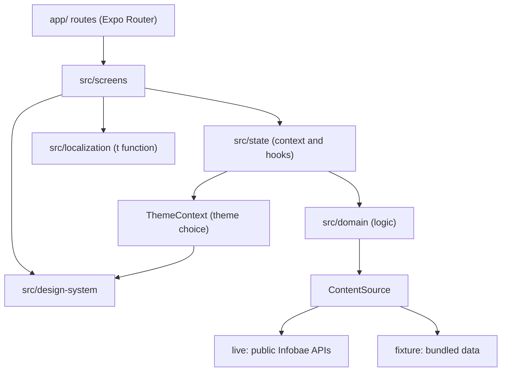
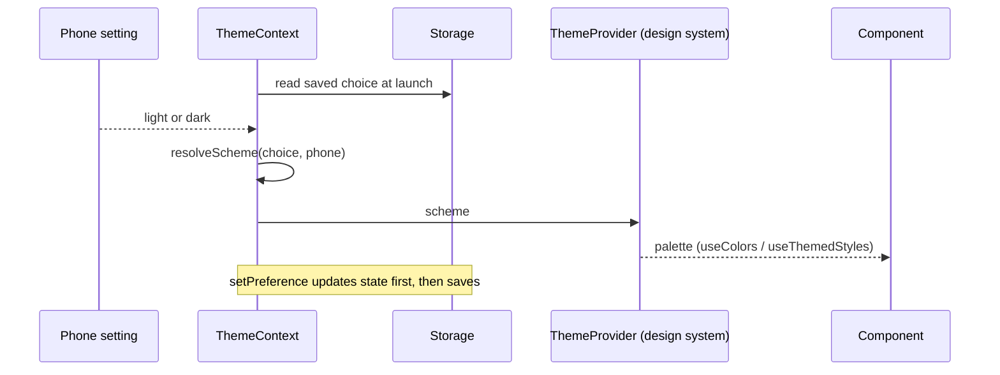
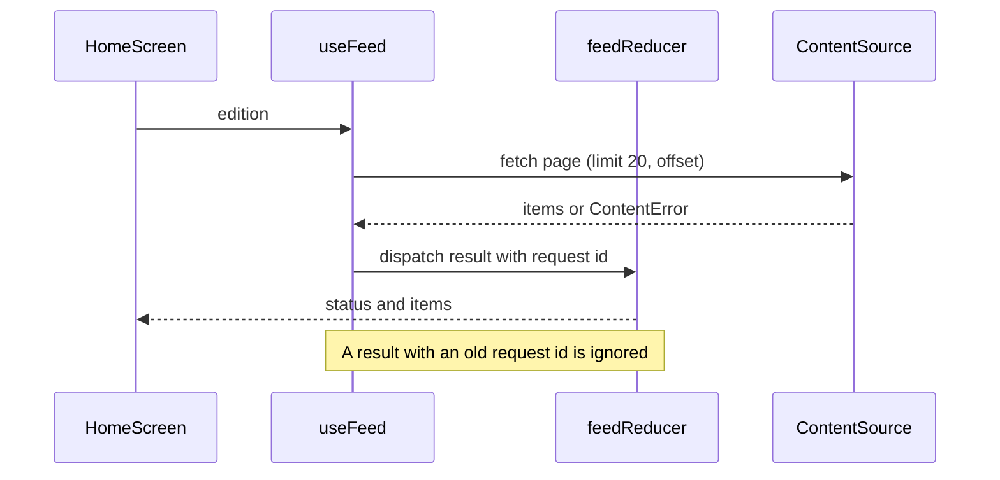
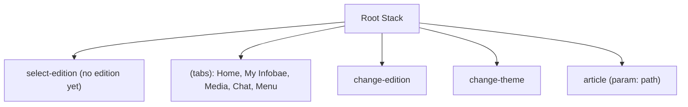

# Architecture

## Layers

- Routes in [`app/`](https://github.com/sunian/infobae-spectra-sandbox/tree/main/app) stay thin. Each one renders a screen from [`src/screens/`](https://github.com/sunian/infobae-spectra-sandbox/tree/main/src/screens).
- Screens use only components from the [design system](https://github.com/sunian/infobae-spectra-sandbox/tree/main/src/design-system).
- State and hooks in [`src/state/`](https://github.com/sunian/infobae-spectra-sandbox/tree/main/src/state) run the logic in [`src/domain/`](https://github.com/sunian/infobae-spectra-sandbox/tree/main/src/domain).
- All text comes from [`en.json`](https://github.com/sunian/infobae-spectra-sandbox/tree/main/src/localization/en.json) through `t()`.

## Theme data flow

[`ThemeContext.tsx`](https://github.com/sunian/infobae-spectra-sandbox/tree/main/src/state/ThemeContext.tsx) holds the choice (`system`, `light`, `dark`). The pure
function `resolveScheme` in [`preference.ts`](https://github.com/sunian/infobae-spectra-sandbox/tree/main/src/domain/theme/preference.ts) turns the choice and the phone setting
into `light` or `dark`. The design system [`ThemeProvider`](https://github.com/sunian/infobae-spectra-sandbox/tree/main/src/design-system/theme.tsx) gives that scheme's palette to
every component. The root layout keeps the splash screen up until the edition and the theme are both read.

## Feed data flow

The reducer in [`feedReducer.ts`](https://github.com/sunian/infobae-spectra-sandbox/tree/main/src/domain/feed/feedReducer.ts) is a pure function with unit
tests. The hook [`useFeed.ts`](https://github.com/sunian/infobae-spectra-sandbox/tree/main/src/state/useFeed.ts) connects it to the source.

## Navigation

The root layout uses `Stack.Protected`. Before an edition is chosen, only `select-edition` can be
reached. After that, the tabs, `change-edition`, `change-theme`, and `article` can be reached. The tab list is in
[`src/navigation/tabs.ts`](https://github.com/sunian/infobae-spectra-sandbox/tree/main/src/navigation/tabs.ts).
