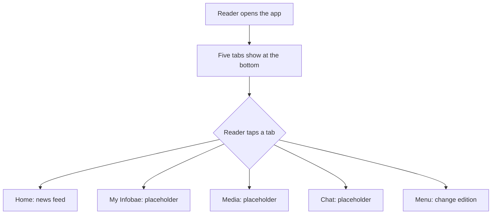

# App shell

## Summary

The app has five tabs at the bottom: **Home**, **My Infobae**, **Media**, **Chat**, and **Menu**.
Home shows the news feed. Menu lets the reader change edition. The other tabs show a placeholder
screen for now. All words on screen come from one text file, so the app can be translated later.

## User journey

## Error and edge cases

| Situation | What the reader sees |
|---|---|
| No network connection | The shell still opens. It needs no network. |
| Device language is not supported | The app shows the default language. No blank text or raw keys show. |
| Small screen or rotated device | The tab bar stays usable. |
| Reader taps a tab many times fast | The last tapped tab shows. The app does not crash. |

## Not yet checked

The app is checked on Android. The iOS check is open until a machine with Xcode is available.
