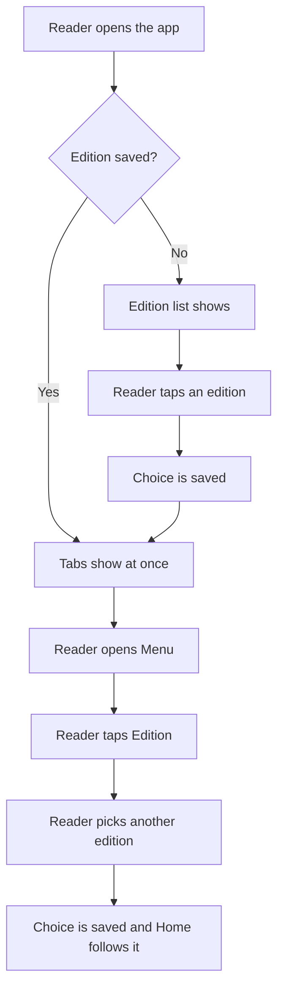

# Edition selection

## Summary

The first time the reader opens the app, a list of editions shows. The reader taps one. The app
saves the choice and shows the tabs. On later launches the tabs show at once. The reader can change
the edition any time from the **Menu** tab.

The editions are: Argentina, Estados Unidos, Colombia, España, México, Perú, Cuba, Centroamérica,
and Mundo.

## User journey

## Error and edge cases

| Situation | What the reader sees |
|---|---|
| The saved edition is no longer in the list | The app asks again, as on first launch. |
| The saved choice cannot be read | The app asks again. It does not crash. |
| Reader taps editions fast on first launch | The last tap wins. The tabs show once. |
| Reader taps the edition that is already selected | Nothing changes. No error shows. |
| Reader closes the app on the edition list | The next launch shows the list again. |
| Small screen or rotated device | The list scrolls. Every edition can be reached. |
| Saving the choice fails (for example, storage is full) | The app uses the choice for this session and does not crash. |
