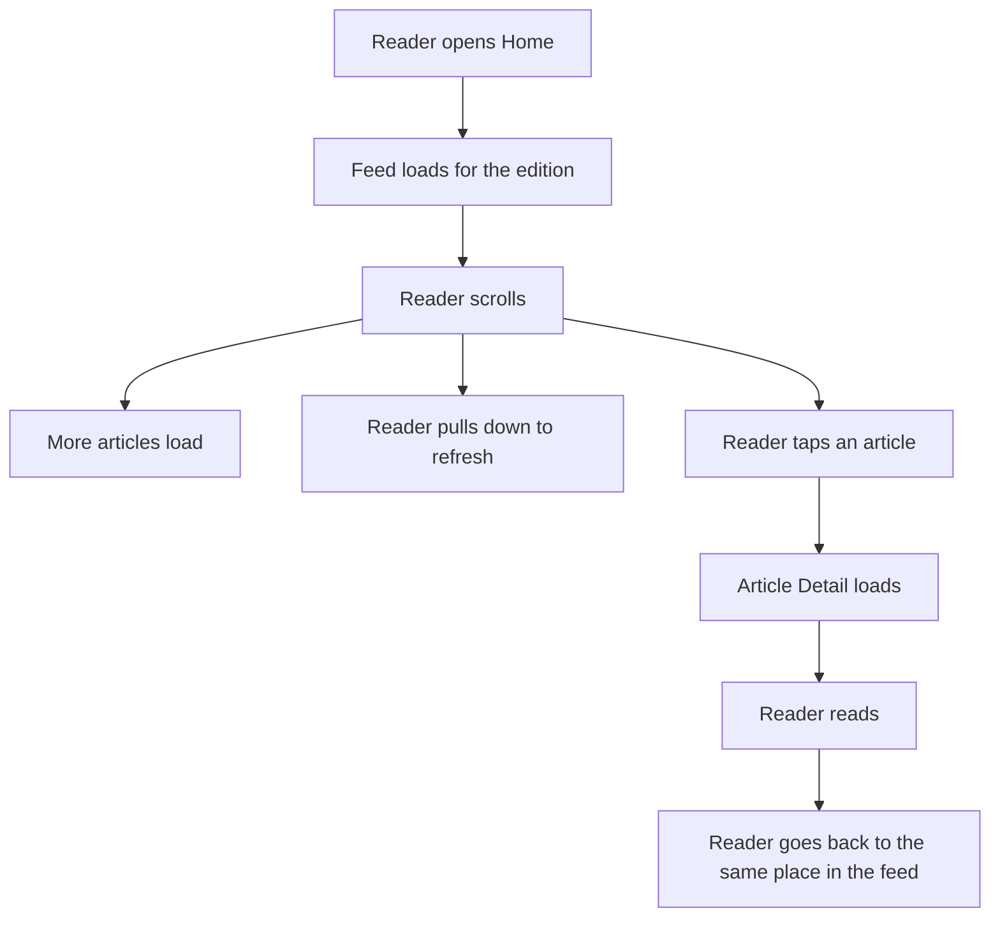
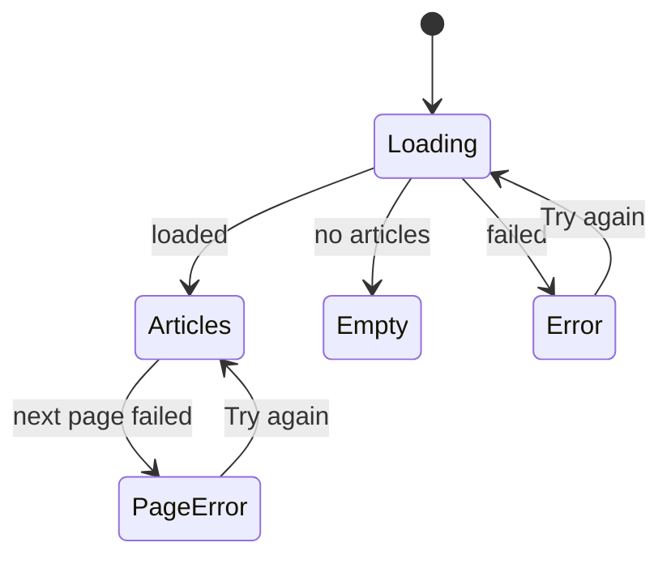

# Home feed and Article Detail

## Summary

The **Home** tab shows a vertical list of articles for the reader's edition. Each item has a
headline, a one-sentence summary, a small image, the authors, and how long ago it was published.
The list loads more articles as the reader scrolls down. The reader can pull down to refresh.
Tapping an item opens **Article Detail**. It shows the headline, subheadline, authors, date,
section, the main image, and the article text with its images.

## User journey

## What the reader sees when loading goes wrong

| Situation | What the reader sees |
|---|---|
| The first page fails (for example, no network) | A short error message and a "Try again" action. |
| The edition has no articles | A message that there are no articles right now. |
| A later page fails | The loaded articles stay. A small "Try again" shows at the end of the list. |
| Pull to refresh fails | The earlier articles stay and a short message says the refresh failed. |
| An article fails to load | An error message and "Try again". The back action still works. |

## Edge cases

| Situation | What the reader sees |
|---|---|
| An item has no headline or no article path | The app leaves that item out. |
| The same article appears in two pages | It shows once. |
| Reader taps two items very fast | Only one article screen opens. |
| Reader leaves the article before it loads | Nothing happens. No error shows. |
| The article text has unsupported or broken formatting | The app shows the plain text. It does not crash. |
| An image fails to load | A neutral grey box shows. The layout does not jump. |
| A very long headline or summary | The feed shortens it. The article screen shows it in full. |
| Landscape or a large font setting | The text stays readable and nothing is cut off. |
| An article has a video or another unsupported block | The app leaves that block out and shows the rest. |
