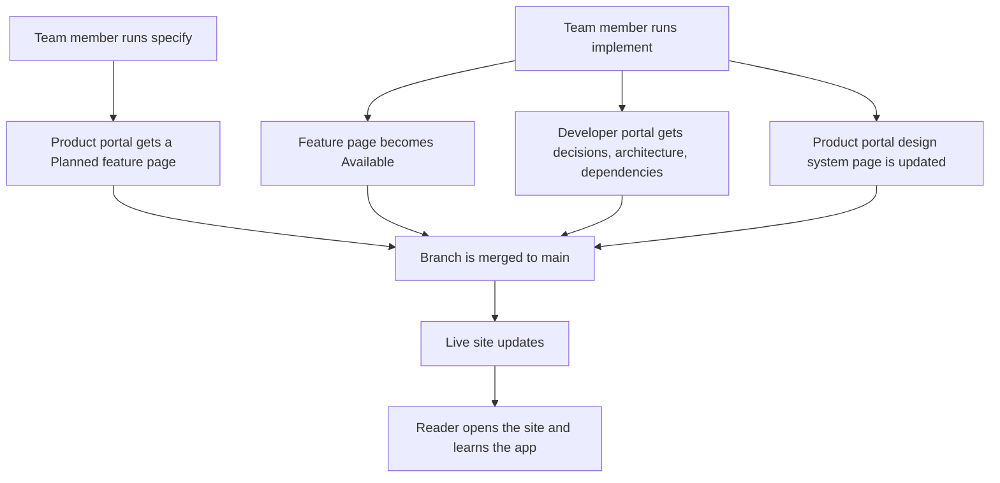

# Documentation portals

> **TL;DR** (max 5 bullets, written for a human reviewer)
> - **What:** Two documentation sites, one for developers and one for the whole team, hosted as GitHub Pages in the app repository.
> - **Why:** New teammates can learn the app quickly, and the docs stay current without manual work.
> - **Scope / Approach / Order:** Product portal, Developer portal, an update after each specify run, an update after each implement run, then publishing.
> - **Biggest risk or open question:** The docs can drift from the app if an update fails or if planned features look finished.
> - **Check this:** Features that are not finished are marked "Planned". This one stays Planned until the live site is checked.

**Status: Planned.** The sites and the automatic updates are built. The feature is not complete until GitHub Pages is turned on and the live site is checked after the merge.

## Summary

The team gets two sites. The **Product portal** explains each feature, its user journey, what the app
does when something goes wrong, and the design system. The **Developer portal** explains the app
architecture, the important decisions and why they were made, the team patterns, and the libraries.
After every specify run and every implement run, the sites update on their own. The sites are short
and easy to read. They do not describe every detail.

## User journey

## Error and edge cases

| Situation | What happens |
|---|---|
| A spec has no user flow or no edge cases | The page shows only the parts that exist. Nothing is invented. |
| A feature is specified, then dropped | The page stays "Planned" until a person removes it by hand. |
| A diagram has a mistake | The update stops and reports which diagram. No broken page is left behind. |
| The update runs twice for the same feature | The same page is updated. No second page appears. |
| An update fails | The user sees a clear message. The spec or the build is not undone. |
| A feature changes the same area as an earlier one | The new text replaces the old text. |
| A page links to a file that moved | The update reports the broken link. |
| The update runs on a branch that is not main | The pages change on that branch and go live after the merge. |
| GitHub Pages is not turned on | The pages are ready but there is no live site. A team member turns it on once in the repository settings. |
