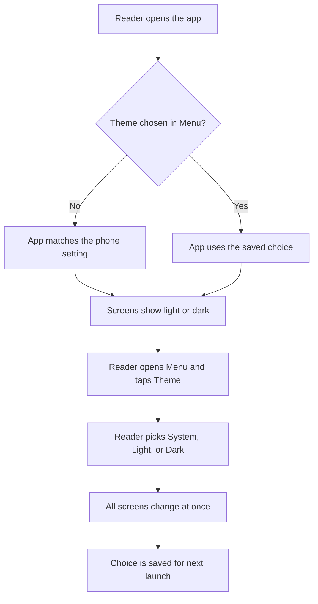

# Dark mode

## Summary

The app has a light look and a dark look. By default it matches the phone. If the phone is dark,
the app is dark. If the phone changes while the app is open, the app changes too, with no restart.

The reader can also choose a look by hand. In the **Menu** tab, the **Theme** row shows the current
choice. A tap opens a list with three choices: **System**, **Light**, and **Dark**. System is the
default and follows the phone. Light and Dark ignore the phone. The app changes at once and
remembers the choice the next time it opens. Every screen supports both looks: the edition list,
Home, the article screen, and the other tabs.

The theme choice and the edition choice are separate. Changing one does not change the other.

## User journey

## Error and edge cases

| Situation | What the reader sees |
|---|---|
| The saved choice cannot be read or is not valid | The app uses System. It does not crash. |
| Saving the choice fails (for example, storage is full) | The app uses the new look for this session. Reading is not blocked. |
| The phone gives no light or dark setting | The app shows the light look when the choice is System. |
| Reader taps the choices fast | The last tap wins. The screen does not flicker. |
| Phone setting changes while the choice is Light or Dark | Nothing changes. The reader's choice stays. |
| Phone setting changes while the theme list shows | Colors update. The mark stays on System. |
| First launch, before any theme choice | The edition list uses the phone's light or dark setting. |
| App opens in dark mode | The app waits for the saved choice, so no bright flash of the light look shows after the splash screen. |
| Choice differs from the phone (for example, phone light and app Dark) | The very first splash screen follows the phone, so it can be light for a moment. |
| Choice differs from the phone | On Android, the phone's own button bar at the bottom keeps the phone's color. |
