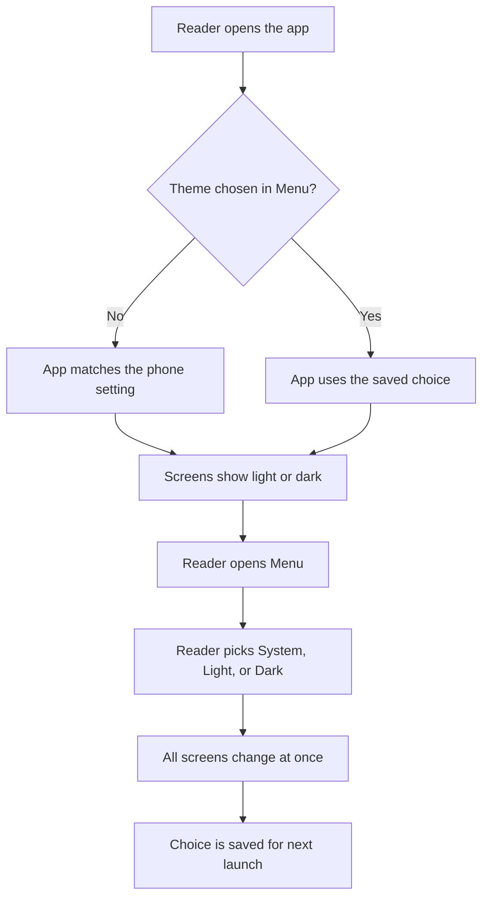

# Dark mode

**Status: Planned.** This feature is specified but not built yet.

## Summary

The app will have a light look and a dark look. By default it matches the phone setting. If the
phone is dark, the app is dark. If the phone changes while the app is open, the app changes too.

The reader can also choose a look by hand in the **Menu** tab. The choices are **System**, **Light**,
and **Dark**. System is the default and follows the phone. Light and Dark ignore the phone. The app
remembers the choice the next time it opens. Every screen supports both looks.

## User journey

## Error and edge cases

| Situation | What the reader sees |
|---|---|
| The saved choice cannot be read or is not valid | The app uses System. It does not crash. |
| Saving the choice fails (for example, storage is full) | The app uses the new look for this session. Reading is not blocked. |
| The phone gives no light or dark setting | The app shows the light look when the choice is System. |
| Reader taps the choices fast | The last tap wins. The screen does not flicker. |
| Phone setting changes while the choice is Light or Dark | Nothing changes. The reader's choice stays. |
| Phone setting changes while the theme list shows | Colors update. The mark stays on System. |
| Image with a white or clear background in dark mode | The image stays readable. |
| First launch, before any theme choice | The edition list uses the phone's light or dark setting. |
| App opens in dark mode | No bright flash of the light look shows after the splash screen. |
